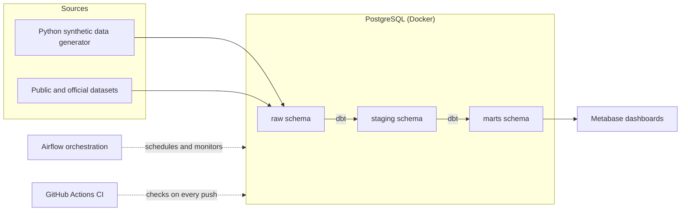
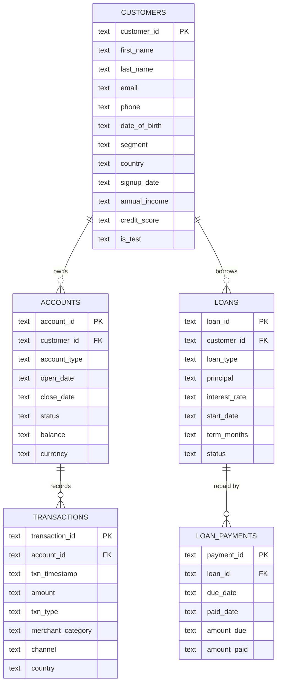

# Architecture

Bank 360 AI is a data platform for a fictional retail bank. It brings customer, account, loan and transaction data into one governed warehouse to support Customer 360, credit risk analytics and fraud monitoring.

## 1. System overview

| Component | Role |
|---|---|
| Python | Generates linked synthetic bank data and loads it into `raw` |
| PostgreSQL | Warehouse (development); runs in Docker |
| dbt | Transforms `raw` into clean `staging` models and business-ready `marts`, with tests |
| Airflow | Orchestrates the pipeline end to end |
| Metabase | Dashboards for Customer 360, credit risk and fraud monitoring |
| GitHub Actions | Automated checks on every push |

## 2. Data layers

| Layer | Schema | What happens | Why |
|---|---|---|---|
| Raw | `raw` | Data loaded exactly as received, all columns as text | Audit trail; transformations can always be re-run |
| Staging | `staging` | Rename columns, fix types, deduplicate, standardize values | One clean version of each source table |
| Marts | `marts` | Joins and business metrics | What analysts and dashboards use |

The platform follows an ELT pattern: load first, transform inside the warehouse. All cleaning is done in versioned, tested dbt SQL, so every number can be traced back to its source.

## 3. Data schema (raw layer)

Every raw table also has a `_loaded_at` timestamp. Raw columns are stored as text, with no database-enforced keys, because real source extracts arrive untyped and may contain duplicates. The keys shown above are logical relationships that dbt tests enforce in staging.

| Table | One row per |
|---|---|
| `customers` | Customer |
| `accounts` | Account (checking, savings or credit card) |
| `loans` | Loan (personal, auto or mortgage) |
| `loan_payments` | Scheduled loan payment |
| `transactions` | Account transaction |

## 4. Marts (planned)

- **Customer 360:** one row per customer with accounts, balances, loans and activity.
- **Credit risk:** loan-level delinquency buckets and portfolio default rate.
- **Fraud monitoring:** flagged transactions and risk signals per customer.

## 5. Data quality approach

The synthetic data intentionally includes real-world problems: duplicate rows, missing values, inconsistent formats and categories, orphaned keys, invalid values and test accounts. Staging models fix these, and dbt tests (`unique`, `not_null`, `relationships`, `accepted_values`) verify the result. Raw tables are never modified.

## 6. Data sources

- **Synthetic data:** generated with Python and Faker so IDs link across tables. Distributions (credit scores, default rates, fraud rates) are calibrated against public data.
- **Public and official data (planned):** Federal Reserve (FRED) benchmark series and a public loan performance dataset, loaded as separate reference tables for benchmarking.

## 7. Design decisions

| Decision | Choice | Reason |
|---|---|---|
| Load pattern | ELT with a `raw` schema | Auditability and reproducibility |
| Development warehouse | PostgreSQL in Docker | Free, local, and close to Snowflake's SQL |
| Orchestration | Airflow | Dependencies, retries and monitoring for pipeline steps |
| Transformation | dbt | Version-controlled, tested, documented SQL models with lineage |
| Dashboards | Metabase | Free, open source, connects live to Postgres |
| Environment | Docker Compose | One command starts the stack on any machine |

## 8. Local environment

Defined in `docker-compose.yml`.

| Service | Image | Port | Purpose |
|---|---|---|---|
| `postgres` | postgres:16 | 5432 | Warehouse holding the `raw`, `staging` and `marts` schemas |
| `metabase` | metabase/metabase | 3000 | Dashboards reading from Postgres |

Credentials are read from `.env` (not committed); `.env.example` is the template. Named volumes keep data when containers are removed.

## 9. Roadmap

- Snowflake deployment
- Text-to-SQL agent
- Data quality agent
- Risk reporting agent
